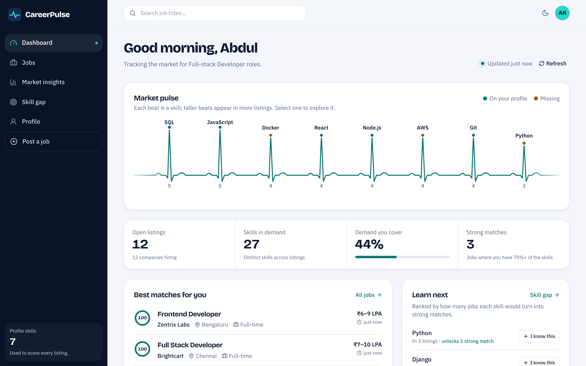
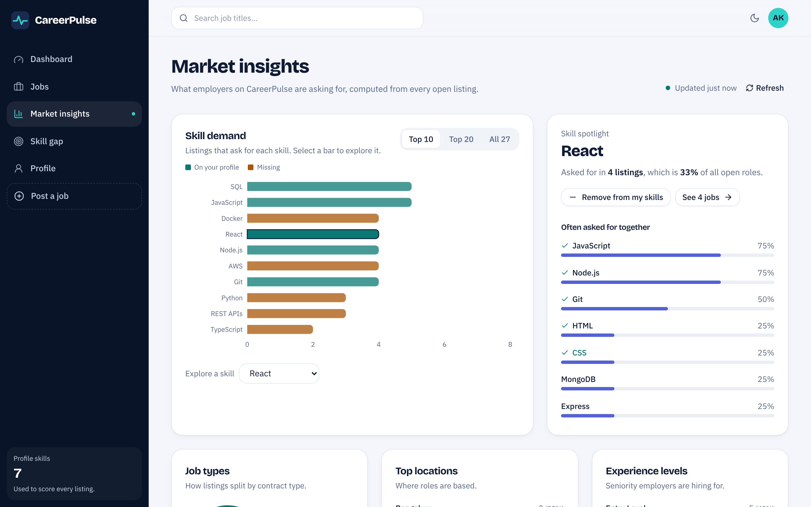
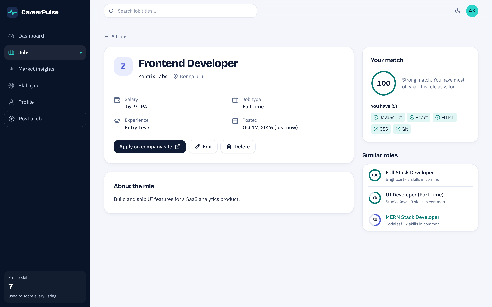
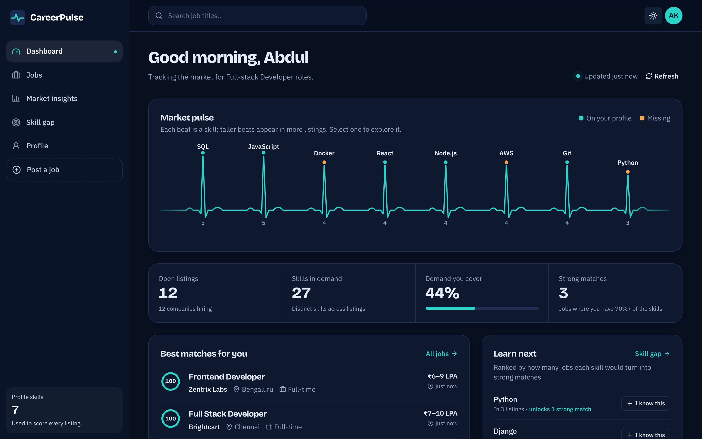

# CareerPulse AI

CareerPulse measures which skills open job listings ask for, scores every job against a user's skills, and ranks the skills that would open the most roles.


## live demo
https://career-pulse-ai-2.vercel.app


## Screenshots







```
CareerPulseAi/
├── backend/    Node.js + Express 5 + MongoDB (Mongoose 9) REST API, JWT auth   → port 5000
└── frontend/   React 18 + TypeScript + Vite + Tailwind CSS                      → port 5173
```

---

## 1. Quick start

Requirements: Node.js 18+ (20 or 22 recommended) and a MongoDB database (Atlas or local).

### Backend

```bash
cd backend
npm install
cp .env.example .env      # skip if you already have .env, then fill in the values
npm run seed              # optional: 12 sample jobs, only if the jobs collection is empty
npm run dev               # or: npm start
```

`backend/.env`

| Variable | Purpose |
| --- | --- |
| `PORT` | API port (5000) |
| `MONGO_URI` | MongoDB connection string |
| `JWT_SECRET` | Long random string used to sign login tokens |
| `ADMIN_EMAILS` | Comma-separated emails that can edit/delete **any** job (optional) |

Using MongoDB Atlas? Add your IP under **Network Access**, or the server exits with "MongoDB connection failed".

### Frontend (second terminal)

```bash
cd frontend
npm install
cp .env.example .env      # VITE_API_URL=http://localhost:5000/api
npm run dev
```

Open http://localhost:5173.

### Connecting the two

The frontend calls the API at `VITE_API_URL`. The backend already enables CORS for all origins, so nothing else is needed locally.
For deployment: build with `npm run build` (output in `frontend/dist/`), host it on any static host, set `VITE_API_URL` to your deployed API **before** building, and configure the host to serve `index.html` for unknown paths (SPA fallback).
The frontend never sees secrets; it only stores the user's login token in `localStorage`.

### Useful scripts

| Where | Command | What it does |
| --- | --- | --- |
| backend | `npm run dev` | API with auto-reload (nodemon) |
| backend | `npm run seed -- --fresh` | **Deletes all jobs**, then inserts the samples |
| frontend | `npm run build` | Type-check + production build |
| frontend | `npm run typecheck` | TypeScript only |

---

## 2. API (what the frontend uses)

| Method | Endpoint | Auth | Notes |
| --- | --- | --- | --- |
| POST | `/api/auth/register` | – | name, email, password (≥ 6 chars) |
| POST | `/api/auth/login` | – | returns `token` |
| GET | `/api/auth/me` | ✔ | full profile + `isAdmin` · **new** |
| PUT | `/api/auth/profile` | ✔ | name, skills[], education, experience, preferredRole · **new** |
| PUT | `/api/auth/password` | ✔ | currentPassword, newPassword · **new** |
| GET | `/api/jobs` | – | all jobs, newest first |
| GET | `/api/jobs/search` | – | `title, skill, location` + **new** `jobType, experience, sort, page, limit` |
| GET | `/api/jobs/:id` | – | **new**; includes poster's name |
| POST | `/api/jobs` | ✔ | **now requires login**; records `postedBy` |
| PUT | `/api/jobs/:id` | ✔ | **new**; poster or admin only |
| DELETE | `/api/jobs/:id` | ✔ | **new**; poster or admin only |
| GET | `/api/analytics/skills` | – | demand per skill |
| GET | `/api/recommendations/:userId` | – | missing skills |

Send the token as `Authorization: Bearer <token>`.

---

## 3. Backend changes (all additive)

Existing endpoints keep their response shapes; fields were only added.

1. **`models/job.js` → `models/Job.js`.** The routes `require("../models/Job")`; that works on macOS but crashes on Linux servers.
2. **Profile, "me" and password endpoints.** Previously there was no way to set a user's skills, so matching and recommendations couldn't work.
3. **Job ownership.** `Job.postedBy` (optional) plus `middleware/auth.js`. Creating a job requires login. Only the poster or an `ADMIN_EMAILS` user can edit/delete. Jobs created before this change have no owner, so only admins can manage them.
4. **Input validation.**
   - Jobs: required fields, job-type enum, http(s) link. Fields are whitelisted, so `postedBy` can't be spoofed.
   - Register: email format and password length.
   - Profile: name, experience range, de-duplicated skills.
5. **Search.**
   - Input is regex-escaped (searching `C++` used to return a 500).
   - Optional filters, sorting and pagination. Without `page` it returns all results, as before.
6. **Error handling.**
   - Invalid ids return 404 instead of 500.
   - Unknown routes and malformed JSON return JSON errors instead of HTML.
7. **Scripts and config.** `npm start/dev/seed` scripts, `seed.js`, `.env.example` and `.gitignore`.

---

## 4. Frontend

**Architecture**

```
src/
├── lib/            api.ts (typed fetch client, token, ApiError) · types.ts · skills.ts (matching math) · format.ts
├── hooks/          queries.ts (TanStack Query hooks + cache invalidation) · useDebounced · useThemeColors
├── context/        Auth (session, 401 → logout) · Toast · Theme
├── components/
│   ├── ui/         Button, Field, Dialog/ConfirmDialog, Menu, Segmented, Pagination, States (skeleton/empty/error), LiveIndicator
│   ├── layout/     AppShell (sidebar, mobile drawer, top bar), Logo, OfflineBanner
│   ├── jobs/       JobCard, JobForm (validation + live preview), SkillInput (autocomplete), MatchRing, delete flow
│   └── charts/     PulseTrace (the live "heartbeat" of skill demand)
└── pages/          Landing · auth/AuthPage · app/{Dashboard, Jobs, JobDetail, JobEditor, Market, SkillGap, Profile}
```

- **Data and sync:** after any create, edit or delete, the jobs, skill-demand and recommendation caches refresh. Market data also refreshes every 30 s while the tab is visible, and when you return to the tab.
- **Matching:** a job's match is the share of its listed skills on your profile. "Unlocks" counts jobs that would reach 70%+ if you added that one skill. The list of missing skills comes from `/api/recommendations`; demand only ranks it.
- **Dependencies:** react, react-router-dom, @tanstack/react-query, recharts, lucide-react, and self-hosted fonts (no external font requests).

**Screens**

- **Landing:** live stats, the skill "pulse", most-requested skills and the latest listings, all from the API.
- **Log in / Create account:** validation, password strength meter, show/hide password, and a return to the page you were trying to open.
- **Dashboard:** market pulse (click a beat to explore that skill), KPIs, best matches, and "learn next" with one-click "I know this".
- **Jobs:**
  - Debounced search by role, skill and location; job-type and experience filters.
  - Sorting: newest, oldest, A–Z, best match.
  - Server-side pagination; a "My postings" tab.
  - Filter chips; all filters are kept in the URL so searches can be shared.
- **Job detail:** your match breakdown, add missing skills, apply link, similar roles, and edit/delete (owner or admin) with a confirm dialog.
- **Post / edit job:** validated form with a live card preview. Non-owners get a "you can't edit this" screen; the backend enforces this too.
- **Market insights:**
  - Skill-demand bar chart (top 10/20/all, click a bar to explore it), and a skill spotlight with "often asked for together".
  - Job-type donut, locations, experience levels, and a companies table.
- **Skill gap:** demand-coverage dial, ranked learning path, "one skill away" jobs, and your skills with demand counts.
- **Profile:** details, skills and password tabs, with an unsaved-changes guard.
- **Everywhere:**
  - Dark mode; toasts; skeleton loaders.
  - Empty and error states with retry; an offline banner.
  - Session-expiry handling; an error boundary.
  - Skip link, keyboard-operable menus and dialogs, reduced-motion support.

---

## 5. Testing performed

- **Unreachable here:** MongoDB Atlas and MongoDB binaries couldn't be reached from the build environment. The tests ran your real Express routes against an in-memory stand-in for the Mongoose calls they use.
- **Run first against your real database:** `npm run seed`, register, post a job.

| Suite | Result |
| --- | --- |
| API (auth, validation, ownership/admin, pagination, filters, C++ search, errors) | 37 / 37 |
| Browser end-to-end (Playwright: every page, CRUD, permissions, session expiry, API-down, deep links, keyboard) | 70 / 70 |
| Layout at 390 px, 820 px, 1280 px, 1440 px | no horizontal overflow on any page |
| axe-core WCAG 2 A/AA, light + dark, 8 pages | 0 violations |
| `tsc` strict + production build | clean |

---

## 6. Known limitations

- **Password reset by email:** not available. It needs an email service plus reset-token endpoints. The login page says so instead of showing a fake link.
- **Changing email and deleting accounts:** no endpoints exist for either.
- **Recommendations are public:** `GET /api/recommendations/:userId` doesn't require login, so anyone with a user id can see that user's skills. Consider adding `requireAuth` and checking that `req.user` matches.
- **Roles are basic:** a user is either an admin (via `ADMIN_EMAILS`) or not. A role field in the database would be needed for anything finer.
- **"Best match" sorting and "My postings":** both are computed in the browser over all matching results, because the backend can't sort by a per-user score. That's fine up to a few thousand jobs.
- **Unused dependency:** `mysql2` is installed in the backend but never used; you can remove it.
